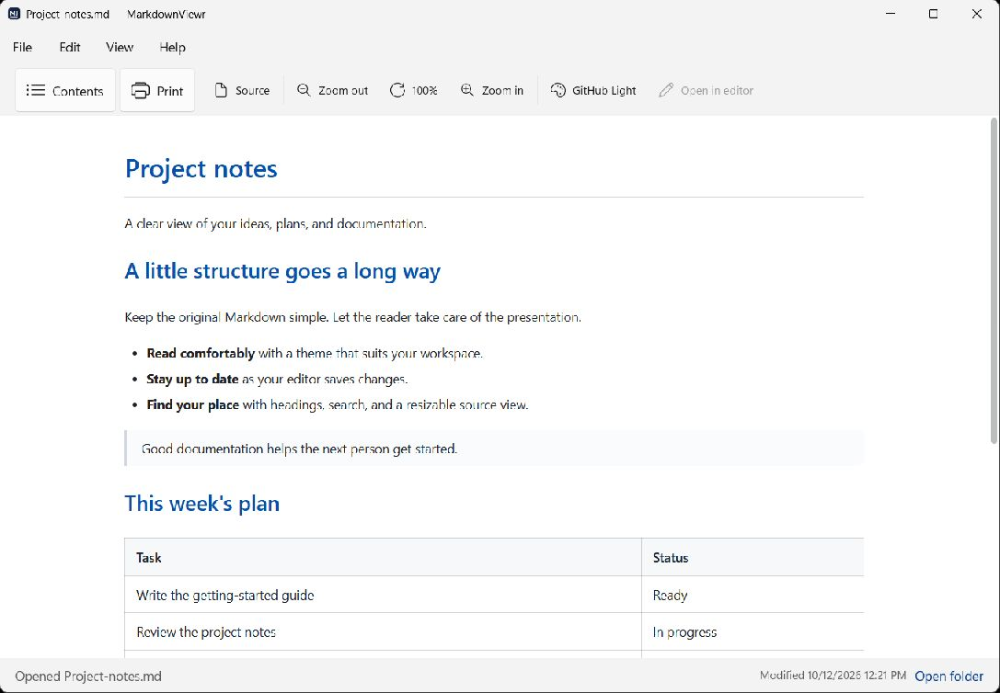
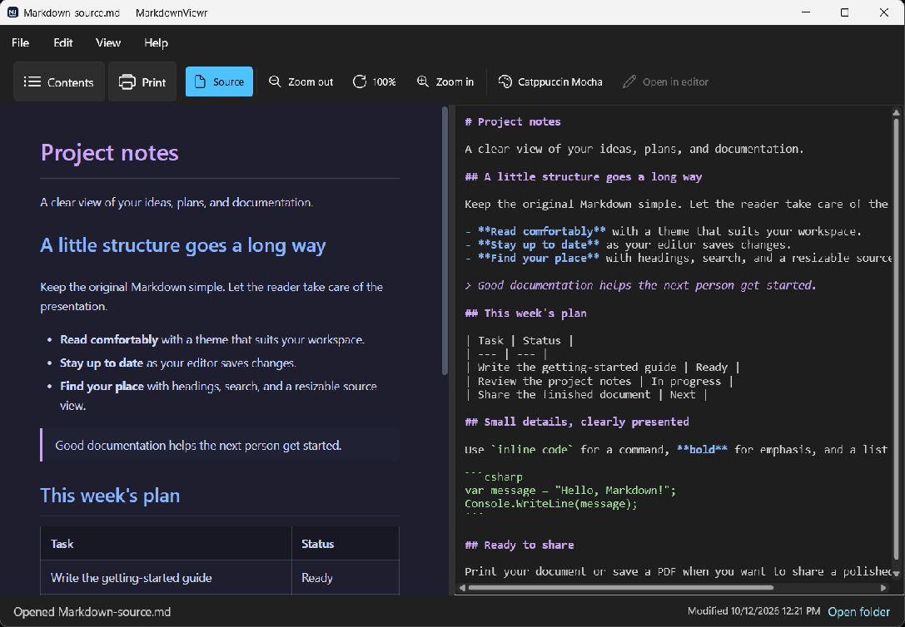

# MarkdownViewr for Windows

Read Markdown comfortably, keep up with changes, and turn your notes into something worth sharing.

MarkdownViewr is a dedicated Windows reader for project documentation, notes, and README files. Open a document, choose a look you like, and focus on the words.

**[Release downloads](https://github.com/KofTwentyTwo/MarkdownViewr.Windows/releases) · [User guide](docs/user-guide.md) · [Ask a question](https://github.com/KofTwentyTwo/MarkdownViewr.Windows/discussions)**

> The first Windows release is being prepared. There are no published Windows downloads yet; the Releases page will contain the stable installer and development previews when publication completes.

## Make Markdown easier to read

- **Make it your own.** Choose from 20 document palettes, customize typography, and use a light, dark, or system app appearance.
- **Follow changes as they happen.** Saved edits refresh automatically. The footer shows the loaded file's modification time and flags an unsuccessful reload.
- **Navigate long documents.** Show Contents, jump between headings, collapse sections, and find text.
- **See how it is written.** Open the highlighted, read-only source alongside the document. The split starts at 50/50 and resizes by dragging.
- **Share a finished document.** Print from the toolbar or save a PDF with separate print styling and optional actions to open the result or its folder.
- **Stay in your workflow.** Open several documents, launch your configured editor, or open the current document's folder in Explorer.

Contents and Source start hidden. Turn them on when needed, or change their new-window defaults in **File → Settings → General**.

## Download and install

The planned Windows packages support **Windows 10 version 1809 or later and Windows 11, x64**. Microsoft Edge WebView2 Runtime is required. No .NET SDK is needed to use a release.

| Edition | Choose it for | Package |
| --- | --- | --- |
| Stable | Everyday reading | `markdownviewr-windows-stable-Setup.exe` |
| Development preview | Trying upcoming changes | `markdownviewr-windows-dev-Setup.exe` |
| Portable | Running without installation | `markdownviewr-windows-stable-Portable.zip` |

Once available, download a package from [Releases](https://github.com/KofTwentyTwo/MarkdownViewr.Windows/releases). Run Setup for a per-user installation without administrator rights, or extract the portable ZIP before launching the app.

Installed editions check for updates through **Help → Check for updates**. Stable and development editions keep separate settings and update channels, so they can coexist. Portable copies do not self-update.

## Quick start

1. Choose **File → Open** or press **Ctrl+O** and select your Markdown file.
2. Use **Theme** to choose a document palette, **Contents** to navigate, and **Source** to inspect the Markdown.
3. Save changes in your editor; the viewer refreshes automatically.
4. Choose **Print** in the toolbar to print or create a PDF.

To open Markdown files in the viewer by default, use an installed copy and choose **File → Settings → General → Choose default file types**. Select MarkdownViewr in Windows Default Apps for your preferred extensions. Windows asks you to make that choice; installation preserves existing defaults.

See the [user guide](docs/user-guide.md) for settings, shortcuts, printing, and troubleshooting.

## Help and feedback

Use **Help → Community support** for questions and **Help → Submit an issue** for bugs or feature requests. You can also visit [Discussions](https://github.com/KofTwentyTwo/MarkdownViewr.Windows/discussions) or [Issues](https://github.com/KofTwentyTwo/MarkdownViewr.Windows/issues) directly.

For a bug report, include the version from **Help → About**, your Windows version, and steps to reproduce. Remove private information from logs and screenshots. Report security vulnerabilities privately using [SECURITY.md](SECURITY.md).

## Developers and contributors

Want to help? Start with [CONTRIBUTING.md](CONTRIBUTING.md). Build commands, tests, architecture, and release verification are in [DEVELOPERS.md](DEVELOPERS.md).

This is a Product-tier project adopting the [KofTwentyTwo standards](https://github.com/KofTwentyTwo/standards), built with AppKit and WinUI 3. OpenSSF enrollment is active; registration does not mean a passing badge has been earned.

## Credits and license

Based on [Darin Kelkhoff's original macOS markdownViewr](https://github.com/darinkelkhoff/markdownViewr). Visit [Darin's website](https://kelkhoff.com/). The Windows app also credits the open-source libraries it uses in **Help → About → Components**.

Free and open source under the [MIT License](LICENSE). Original-author and dependency notices are preserved in [THIRD-PARTY-NOTICES.md](THIRD-PARTY-NOTICES.md).
